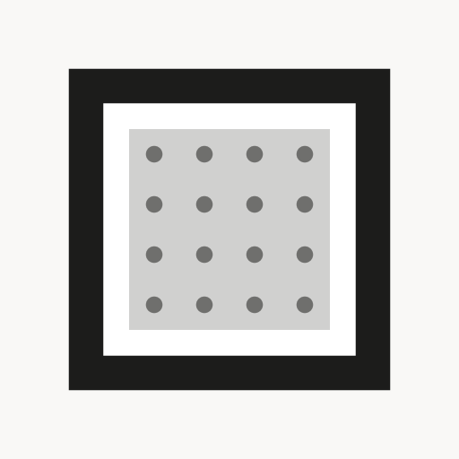

<div align="center">

  

  # Zenso
  
  **A window to calm living.**

  Smart, connected 7-color e-Paper displays and an open widget platform designed for ambient, distraction-free spaces.

  <p align="center">
    <a href="https://zenso.ink"><strong>zenso.ink</strong></a> •
    <a href="https://schemas.zenso.ink"><strong>schemas.zenso.ink</strong></a> •
    <a href="https://github.com/zensoink/zenso-plugin-template/blob/master/GUIDE.md"><strong>Plugin Developer Guide</strong></a>
  </p>

  <p align="center">
    
    
    
    
  </p>

</div>

---

### 🌿 What is Zenso?

Zenso reimagines smart home dashboards and digital frames as **calm technology**. Instead of glowing screens, notification banners, and aggressive backlights, Zenso uses physical **7-color Advanced Color e-Paper (ACeP)** displays that look like museum-grade printed paper.

- 🎨 **Natural Paper Aesthetic**: High-contrast, matte, glare-free viewing in direct sunlight or ambient room lighting.
- 🔋 **Weeks of Battery Life**: Deep-sleep hardware design waking up only to refresh content silently over Wi-Fi.
- 🧩 **Zero-JS by Default**: Server-side rendering (Liquid → HTML → Headless Chromium → Dithered 4bpp image) ensures devices remain lightweight and battery-efficient.
- 🏠 **HomeLab & Open Ecosystem**: Fully self-hostable with public Docker containers and unrestricted device limits for hobbyists.

---

### 📦 Ecosystem & Repositories

The Zenso ecosystem is modular, transparent, and built for both hardware enthusiasts and web developers.

```
                               ┌───────────────────────────┐
                               │   zenso-plugin-template   │  (Liquid + CSS Widgets)
                               └─────────────┬─────────────┘
                                             │  build & pack via @zenso/vite-plugin
                                             ▼
┌───────────────────────────┐  HTTP API   ┌───────────────────────────┐
│       zenso-firmware      │ ◄────────── │     zenso-api & panel     │  (SSR, Scheduling,
│ (ESP32-S3 / Waveshare 7") │             │ (Docker / HomeLab Self-Host) Fleets & Dithering)
└───────────────────────────┘             └───────────────────────────┘
```

#### 🖥️ Firmware & Hardware
- **[zenso-firmware](https://github.com/zensoink/zenso-firmware)** — Open source ESP32-S3 firmware for Waveshare 7.3" ACeP panels. Includes captive portal Wi-Fi provisioning, power management, OTA updates, and encrypted API communication. *(GPL-3.0)*

#### 🛠️ Developer SDK & Tooling
- **[zenso-plugin-template](https://github.com/zensoink/zenso-plugin-template)** — The official starter template for creating e-ink widgets with hot-reloading dev preview and mock data layers. *(MIT)*
- **[vite-plugin](https://github.com/zensoink/vite-plugin)** (`@zenso/vite-plugin`) — Build tooling for Liquid template compilation, schema validation, and `plugin.zip` packaging. *(Apache-2.0)*
- **[zenso-schemas](https://github.com/zensoink/zenso-schemas)** — Canonical JSON schemas and contracts (`schemas.zenso.ink`) establishing ecosystem-wide interoperability. *(Apache-2.0)*

#### 🔌 Official Reference Plugins
- **[plugin-calendar](https://github.com/zensoink/plugin-calendar)** — Daily and monthly calendar agenda synced from Google Calendar or Apple iCloud via ICS feeds. *(MIT)*
- **[plugin-immich](https://github.com/zensoink/plugin-immich)** — Turn your e-ink display into an ambient photo frame powered by your self-hosted Immich library. *(MIT)*
- **[plugin-image](https://github.com/zensoink/plugin-image)** — Dynamic image feeds, webcams, daily artworks, and photography. *(MIT)*

---

### 🚀 Creating Your First Plugin

You can build and preview widgets locally in seconds using standard web technologies (HTML, CSS, Liquid templating):

```bash
# 1. Clone the template
git clone https://github.com/zensoink/zenso-plugin-template my-zenso-widget
cd my-zenso-widget

# 2. Install dependencies
npm install

# 3. Start local development with hot reload and mock datasets
npm run dev

# 4. Package your plugin into plugin.zip
npm run build
```

Read the full **[Plugin Authoring Guide](https://github.com/zensoink/zenso-plugin-template/blob/master/GUIDE.md)** for details on configuration schemas, server-side data fetching, and asset helpers.

---

### 🤝 Community & Licensing

Zenso believes in sustainable open source and community empowerment:

- **Firmware, Plugins & Tooling** are openly licensed under **MIT**, **Apache-2.0**, and **GPL-3.0**.
- **Self-Hosting Platform (API & Panel)** is distributed under the **Zenso Fair-Code License**, granting free, unrestricted usage for personal home automation and HomeLab enthusiasts.
- **Enterprise**: Need custom hardware integration, white-label displays, or commercial fleet licensing? Reach out to [enterprise@zenso.ink](mailto:enterprise@zenso.ink).

<div align="center">
  <sub>Crafted with tranquility by <a href="https://zenso.ink">Zenso</a>.</sub>
</div>
